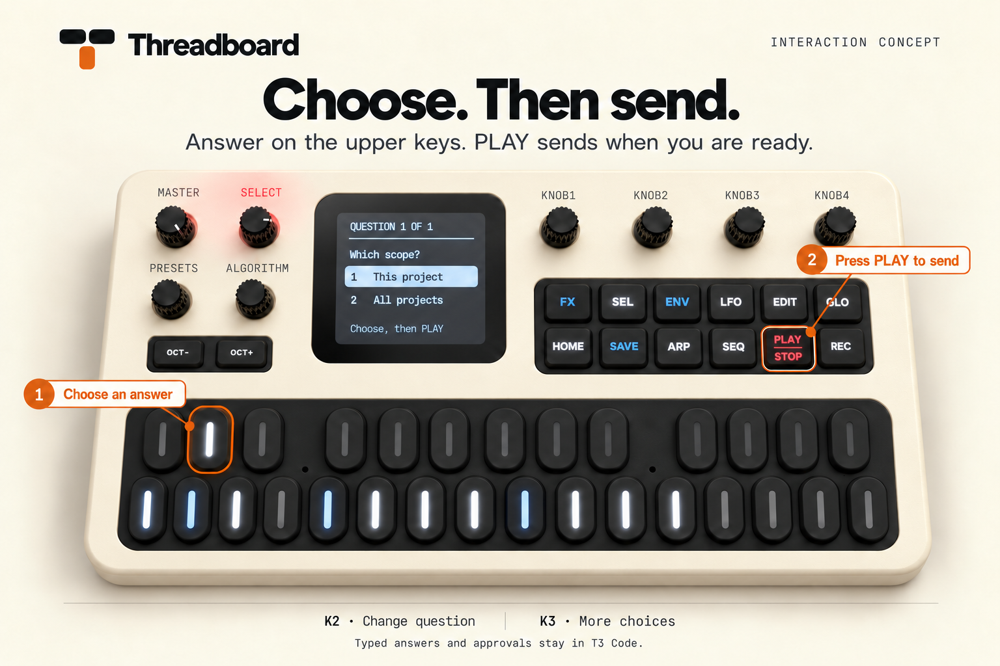

# Threadboard

**Your threads, at hand.**

Turn an M-VAVE FM-1 into a physical console for your T3 Code, Codex, or Claude Code threads.


*Interaction concept based on the physical board. Screen layouts are illustrative;
amber marks highlight controls, not hardware LED colors.*

Choose a thread source in the local dashboard. [Set up Threadboard](#run-it),
follow the [illustrated interaction guide](docs/interactions.md), or see the
[brand and icon assets](docs/branding.md).

Each active, top-level thread gets one of the 16 white keys. Its key stays fixed
through new runs, completion, app restarts and USB reconnects. Settling the
thread releases that key. New threads fill empty keys without moving others.

| Key light | Meaning |
| --- | --- |
| Flashing | A question, approval, response, plan or completed thread needs you |
| Steady bright | Work is running |
| Dim | Assigned, with nothing to handle right now |
| Slowly breathing | Snoozed, with a gentle 4.5-second fade |
| Off | Available |

Pending questions take priority even when the agent keeps working. Completed
threads keep flashing after you read them, until you settle them. A completed
foreground run with active or pending background work is still waiting, not done;
it stays steadily lit until that work finishes. Reading a question does not clear
the pending request. Snoozed threads breathe until the snooze ends. If the bridge disconnects, the
device stops showing live activity and displays that T3 is disconnected.

Non-blocking questions still flash on Threadboard while the agent works. T3's
current sidebar may keep those threads under Working until the run stops.

The 11 black keys choose answers for the selected thread. Single-choice answers
advance to the next question; multi-select answers toggle in place. Nothing is
sent until you press PLAY. Threads keep their white key while answering.

K2 switches questions; K3 changes pages when there are more than 11 options.
K1 scrolls the full question and labels on the device. Available option keys
light at middle brightness; selected choices light at full brightness. Unused
black keys stay off. Questions requiring typed text and
approval requests stay in T3. Drafts stay in memory and reset if the request changes.
An unconfirmed submission stays locked so a retry cannot send it twice.



*Choose first, then send. Typed answers and approvals stay in T3 Code.*

## Controls

| FM-1 control | Action |
| --- | --- |
| White key | Open that thread in T3 Code and select it on the FM-1 |
| SEL | Open the next thread needing attention |
| REC | Stop the selected thread's work, including delegated work |
| SAVE held + white key | Settle that thread after its work and requests are handled |
| Black key | Choose or toggle the corresponding answer |
| PLAY | Send completed answers, or reopen the thread when no question is shown |
| K2 | Previous or next question |
| K3 | Previous or next page of choices |
| K1 | Scroll the response preview on the device |
| HOME | Show the control reference |
| MASTER | Chime volume, with mute at zero |

The physical PLAY/STOP key has PLAY above STOP and red illumination. It is in
the bottom row of the button bank to the right of the screen, four buttons
to the right of HOME, between SEQ and REC. This guide calls it PLAY.

The screen shows the project, thread title, status and the selected thread's
latest message, including while work is running or stopped. K1 scrolls it.
Finished threads show the latest saved assistant response from that run, even
when a later user message exists. PLAY opens the full thread in T3; SAVE + its
white key settles it. Reading the excerpt keeps the thread flashing. Excerpts
use the agent's response directly, without another AI call, and show up to 1,200
characters. Longer messages remain in T3. Both the local bridge and desktop
adapter read saved thread messages because T3's thread list can omit them.
Failed reads retry automatically; a previous run's result is never reused for a
new run. Questions take priority over message previews.
The other knobs are unused in this first version. A short two-note chime plays
when a thread finishes or raises a new request, response, plan or failure needing attention.
Repeated polls and reconnects do not replay the same notification. The initial
snapshot is silent. Simultaneous alerts share one chime.

## Run it

Requires macOS and Node 24 or newer. Choose one of T3 Code, an installed Codex CLI,
or local Claude Code sessions. T3 Code requires a running installation supporting
orchestration protocol 2. Tested against T3 Code Nightly
`0.1.3-nightly.20261025.3692`.

The repository contains source, without prebuilt firmware or personal state.
Start with one of the supported thread sources and an FM-1 running Threadboard
firmware. Follow **Install on the FM-1** below if the device still needs firmware.
Install Apple's command line developer tools for `swiftc`, then run:

```sh
git clone https://github.com/NotAKerbal/threadboard-fm1.git
cd threadboard-fm1
npm ci
npm run build:midi
node scripts/build-desktop.mjs
npm start
```

Open **http://127.0.0.1:4781**, expand **Thread source**, choose **T3 Code**, **Codex**,
or **Claude Code**, and press **Save source**. Each defaults to its standard home
directory, with `CODEX_HOME` and `CLAUDE_CONFIG_DIR` respected when set. You can
enter another directory. Settings are saved in `.state/config.json` and survive
restarts. Setup works even when T3 Code is not installed.

| Source | Threads and controls |
| --- | --- |
| T3 Code | Live status, open in T3, stop, settle, and supported question answers. |
| Codex | Live status, streaming previews, stop, and choice answers through the shared local server. Saved history remains available when the shared server is unavailable. |
| Claude Code | Live foreground/background status through `claude agents --json`, stop for background sessions, and saved history. Optional launch hooks add streaming previews and choice answers. |

The dashboard identifies live, history, and hook setup modes. White keys select a
preview. Choice questions use the black keys and require PLAY to send. Permission
approvals and typed answers stay in the provider. Settling a Codex or Claude thread
hides it only in Threadboard, until a new run or new history arrives.
It does not archive or delete the provider's conversation. Each source and home
directory keeps its own key assignments. Claude's transcript format is internal
and may require updates for new releases, as described in its
[session documentation](https://code.claude.com/docs/en/sessions#where-transcripts-are-stored).
Codex uses the documented [App Server API](https://developers.openai.com/codex/app-server/).

### Live Codex sessions

Threadboard connects to the shared server's local Unix control socket using
WebSocket framing. Start the server if it is not already running:

```sh
codex app-server daemon start
```

Run or resume sessions through that shared server. Threadboard rejoins loaded
sessions without starting a turn or changing their settings, and receives
streamed messages, completion, question and permission events. REC interrupts the
current turn and checks the resulting state. Choice answers wait for the server
to confirm the request was resolved. Closing Threadboard closes its connection;
it does not stop the shared daemon or your work.

Use **Codex control socket** in settings or `--codex-socket /path/to/socket` for a
different local server. Sessions owned by a separate private app-server, including
some desktop or IDE installations, remain history-only unless you connect to that
server's control socket. When the socket is unavailable, the bridge falls back to
saved history and retries the live connection every 30 seconds.

### Live Claude Code sessions

Recent Claude Code versions provide the supported
[`claude agents --json --all` interface](https://code.claude.com/docs/en/agent-view#list-sessions-as-json).
Threadboard polls it for foreground and background sessions, including permission
and input waits. REC uses `claude stop` only for a background session, with its
identity checked again before dispatch. Foreground work must be stopped in Claude.
Older CLIs fall back to saved history and optional hooks.

For streaming previews and board-based choice answers, run the **Enable live
sessions** or selected thread's **Resume** command shown in the dashboard. It
passes a generated `--settings` file to Claude. Your global and project settings
are not edited. This also works when the bridge is restarted during a run.

The [hooks](https://code.claude.com/docs/en/hooks) record lifecycle events in
private files under `.state/claude-live-*/`. `AskUserQuestion` waits for board
answers for up to about ten minutes, then falls back to Claude's normal prompt.
PLAY sends answers once; success requires Claude's `PostToolUse` event, not only
a local file write. Other hooks return promptly. Stop events include background
work, so an unfinished background task keeps the key working. Dead session or
question-hook processes cannot accept answers. A live status that has not updated
for 30 minutes becomes unavailable rather than claiming continued activity.

Tested with Codex CLI `0.164.0` and Claude Code `2.1.310`. Run
`npm run test:providers` to exercise those installed CLIs against local mock model
servers, with isolated homes and no paid model calls. The default test suite uses
fixtures and does not need either CLI installed.

With T3 selected, the bridge connects to all projects in the local
Mac's T3 environment until the desktop adapter is attached. The adapter then
uses every machine in the desktop's connection list automatically.

The bridge obtains a short-lived local T3 session with only orchestration read
and operate scopes. The local session stays in memory and is revoked on normal exit.
The local dashboard binds to 127.0.0.1. No cloud service or model API key is needed.

## Follow the desktop's remote machines

Threadboard can follow the same live thread snapshots and authenticated command
dispatcher the desktop UI uses. Adding or removing a machine in T3 updates the
board automatically. No pairing links or credentials need to be copied for each
remote. The machine name appears alongside the project.

The current T3 release has no public combined-desktop API. This version provides
a small adapter for Nightly `0.1.3-nightly.20261025.3692`:

1. Start Threadboard.
2. Open T3's developer console with Command-Option-I and select Console.
3. Review `bridge/desktop-adapter.js` and `bridge/thread-messages.js`. If DevTools shows its paste warning, clear
   that warning yourself by typing `allow pasting` and pressing Enter.
4. T3 blocks external script imports. The command in `output/install-desktop.txt`
   verifies the reviewed adapter and message reader's combined SHA-256 hash, then loads them as an inline module.
   Review and approve this adapter before running the command: it bypasses that
   external-script restriction and can stop, settle and answer threads. Then
   run the command and close DevTools.
   Do not disable T3's content security policy or other browser protections.

The adapter runs until T3's window reloads or exits. Re-run the command after a
reload. It reconnects automatically if only Threadboard restarts. T3 updates may
require a matching adapter. This is an interim integration, not a native T3 plugin
or an installed background extension. Stop it with `threadboardDesktop.stop()`.

The local channel accepts only the `t3code://app` browser origin and uses a fresh
session capability. T3 credentials stay inside T3. The channel accepts thread
snapshots plus stop, settle and question-answer commands. Cached remote state remains visible as
unavailable while disconnected, reserves its keys and cannot receive commands.

Options:

```sh
node bridge/main.ts --port 4781 --t3-home "$HOME/.t3"
node bridge/main.ts --t3-cli /path/to/t3 --midi-name 'Felucca'
node bridge/main.ts --source codex --codex-home "$HOME/.codex"
node bridge/main.ts --source claude --claude-home "$HOME/.claude"
node bridge/main.ts --source codex --codex-cli /path/to/codex --no-midi
node bridge/main.ts --source claude --claude-cli /path/to/claude --no-midi
node bridge/main.ts --no-midi --smoke
```

`THREADBOARD_T3_APP` selects the desktop application used for thread deep links;
it defaults to `T3 Code (Nightly)`. `T3CODE_CLI_PATH` overrides CLI discovery.
Command-line source and home options override the saved settings for that run.
Use **Save source** in the dashboard to persist them.

Assignments are stored atomically in `.state/bindings-<environment>.json`.
Keep this file to preserve muscle memory. Switching from the original 27-key
layout saves a `.before-white-keys` backup, keeps existing white-key positions,
and moves black-key bindings into free white positions. Any excess bindings
wait in a durable queue until a white key is released. A lock prevents two bridges from
modifying it together. Missing live threads keep their slot until an explicit
settled, archived or deleted state arrives; a complete successful history scan
can release removed sessions. Corrupt saved state fails visibly
instead of silently rearranging keys. More than 16 active threads wait for an
empty key; they never evict assigned threads.

## Install on the FM-1

First follow **Build and verify** below to produce **output/threadboard.fwsc**.
It replaces the synthesizer firmware with the thread console. This version has
been installed on an FM-1 running original M-VAVE V15 firmware; its MIDI command
path and audible chime have been checked on that unit.

Prepare the installer environment:

```sh
python3 -m venv .cache/installer
.cache/installer/bin/pip install -r scripts/installer-requirements.txt
```

1. Connect the FM-1 to the Mac with a USB data cable. Export any sounds/settings
   you want to keep using the editor for its current firmware.
2. Stop Threadboard and other applications using the FM-1's MIDI port.
3. Identify the device without writing anything:

   ```sh
   .cache/installer/bin/python scripts/install-firmware.py
   ```

4. Once its existing firmware is identified and backed up, start the interactive
   installer:

   ```sh
   .cache/installer/bin/python scripts/install-firmware.py --flash
   ```

   It asks before writing and verifies the installed identity afterward. Keep
   power and USB connected. If it identifies M-VAVE's **FM1 Open** firmware,
   its upstream installer requires returning to the original firmware first.
   Do not force that check.

5. Start `npm start`. macOS names the MIDI endpoint **Felucca**; the USB device is **Threadboard FM-1**.
   The device receives the saved thread assignments automatically.

The bootstrap downloads the original M-VAVE V15 recovery package locally as
`output/stock-FM-1_015.fwsc`, fetched from M-VAVE's official source repository.
It is a firmware rollback file, **not a backup of your personal sounds**.

## Build and verify

Firmware builds also need Python 3.9 or newer, Git, curl, a C compiler for the
host checks, and Docker or Colima for the Linux compiler on macOS.

```sh
sh scripts/bootstrap.sh
python3 -m venv .cache/build
.cache/build/bin/pip install -r scripts/build-requirements.txt
npm run check
npm test
.cache/build/bin/python scripts/build-firmware.py --host
npm run test:firmware
```

Firmware builds use the pinned fm1-base and felucca-bsp revisions in
`THIRD_PARTY.md`, JieLi's Linux PI32v2 compiler, and three hash-checked AC79 SDK
packaging files. `bootstrap.sh` downloads them, the SDK license and stock recovery
firmware into this workspace and checks their hashes. The default bitmap fonts
use Pillow and do not require libraqm.

On this Apple Silicon Mac, the compiler runs in a small Colima VM:

```sh
colima start fm1-build --cpu 2 --memory 2 --disk 10 --root-disk 10 \
  --vm-type vz --vz-rosetta --activate=false --ssh-config=false \
  --mount "$PWD:w"
DOCKER_CONTEXT=colima-fm1-build .cache/build/bin/python scripts/build-firmware.py
python3 scripts/package.py
colima stop fm1-build
```

The build checks memory bounds, unsafe register access, RAM-code calls and
CPU-specific instruction hazards before creating the package. Its USB update
loader remains available for future updates.

Additional checks:

```sh
# Starts its own fresh simulator:
npm run test:browser

# Test the real macOS MIDI transport without a physical FM-1:
swiftc -O -module-cache-path .cache/swift tests/MidiVirtual.swift \
  -o output/threadboard-virtual-midi -framework CoreMIDI -framework Foundation
node tests/midi-loopback.mjs
node tests/midi-bridge.mjs
```

The firmware scenarios feed TypeScript-produced SysEx frames into the actual C
app, exercise note keys and buttons, verify light phases, disconnect/reconnect,
and decode its outgoing commands back in the TypeScript bridge. Audio checks
record the C render, verify one notification per event, and measure MASTER volume
and mute. Question scenarios verify black-key choices, PLAY submission and
stale-question tokens. Browser tests
exercise the full simulator flow and mobile layout. The `.fwsc` binary is also
boot-tested separately in the FM-1 hardware emulator. These checks do not replace
validation on the physical unit.

## Source layout

- `bridge/`: T3, Codex and Claude Code sources, durable key assignments, local dashboard server and native
  CoreMIDI transport.
- `firmware/`: the C app running on the FM-1, built on fm1-base.
- `simulator/`: interactive keyboard and thread display, backed by the same board
  controller as the hardware.
- `tests/`: behavior, browser, protocol and firmware scenarios.
- `output/`: firmware package, native helper, screenshots and verification logs.

The bridge exchanges snapshots and commands with the FM-1 over USB MIDI. Every
key command carries its current assignment token and USB session identity;
duplicate commands are acknowledged once, and stale commands are rejected.
Snapshots take effect only when every key has arrived, so incomplete transfers
cannot show a partially reassigned keyboard.

See `THIRD_PARTY.md` for the upstream platform and font notices.
