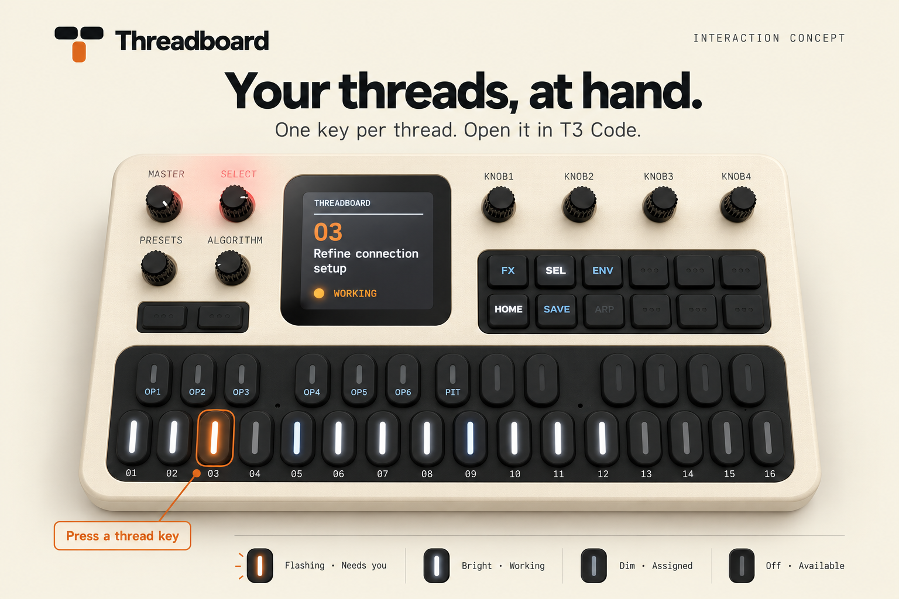
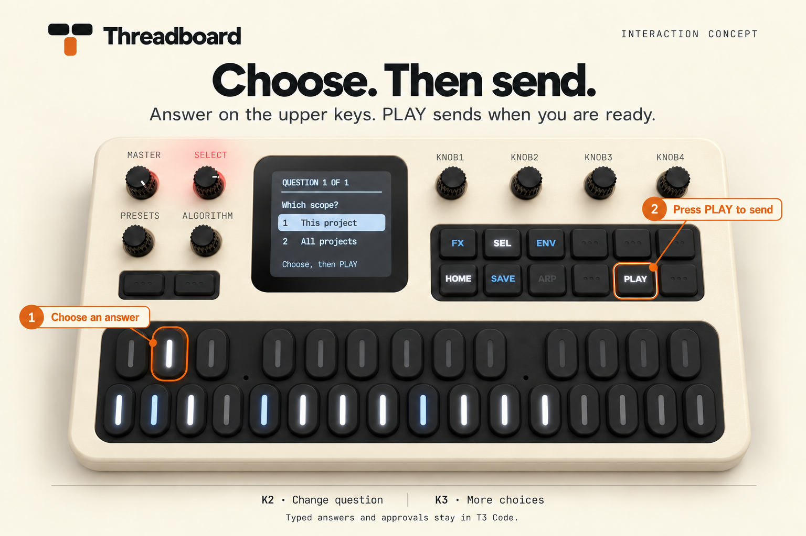
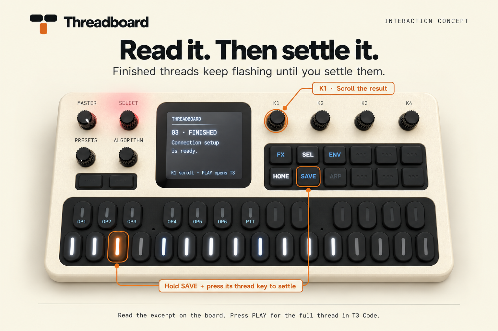

# Using Threadboard

Threadboard connects the FM-1 to your running T3 Code installation. Start with
the [live setup instructions](../README.md#run-it).

These concept illustrations use the physical board as a reference. Screen
layouts and key details are illustrative. Amber outlines identify controls;
they do not describe the hardware's LED colors. The instructions below describe
the current controls.

## Open a thread

Press a white key to select its thread on the board and open it in T3 Code.
Threadboard assigns threads to the 16 white-key positions. Those assignments
stay fixed through new runs, completion, restarts and USB reconnects. The
physical keycaps are dark; "white" and "black" refer to their musical positions.

| Light | Meaning |
| --- | --- |
| Flashing | The thread needs you, including a question or a finished result |
| Steady bright | Work is running |
| Dim | The key is assigned, with nothing to handle right now |
| Off | The key is available |

Press **SEL** to open the next thread needing attention. Press **REC** to stop
the selected thread's work, including delegated work.

## Answer a question

PLAY is four buttons to the right of HOME in the bottom row of the button bank
to the right of the screen. It is second from the right edge.

1. Select the thread asking the question.
2. Press a black key for the corresponding answer. A single choice advances
   to the next question. Multi-select choices toggle and stay on that question.
3. Use **K2** to change questions and **K3** to change option pages when needed.
4. Press **PLAY** after answering the required questions to send your choices.

Available answer keys light at middle brightness; selected choices light at
full brightness. Choosing an answer does not send it. The thread keeps its
assigned white key throughout.

Use **K1** to scroll the question and answer labels. Typed answers and approval
requests stay in T3 Code. Reading a request does not clear it. If a request
changes, its unsent choices reset.

## Read and settle finished work

1. Press the finished thread's white key to read its response excerpt.
2. Turn **K1** to scroll. Press **PLAY** to open the full thread in T3 Code.
3. After its work and requests are handled, hold **SAVE** and press that
   thread's white key to settle it and release the key.

Reading a result keeps the key flashing. Settling is a separate action. If
background work is still running, the thread remains working until it finishes.

The board shows an excerpt of the agent's response directly. Longer results
remain available in T3 Code.

## Disconnect and reconnect

If T3 disconnects, Threadboard stops showing live activity and preserves the
assignments. Reconnect T3 to continue. An unavailable remote machine keeps its
keys reserved and cannot receive commands while disconnected.

Use **HOME** for the control reference. **MASTER** sets chime volume, with mute
at zero.
